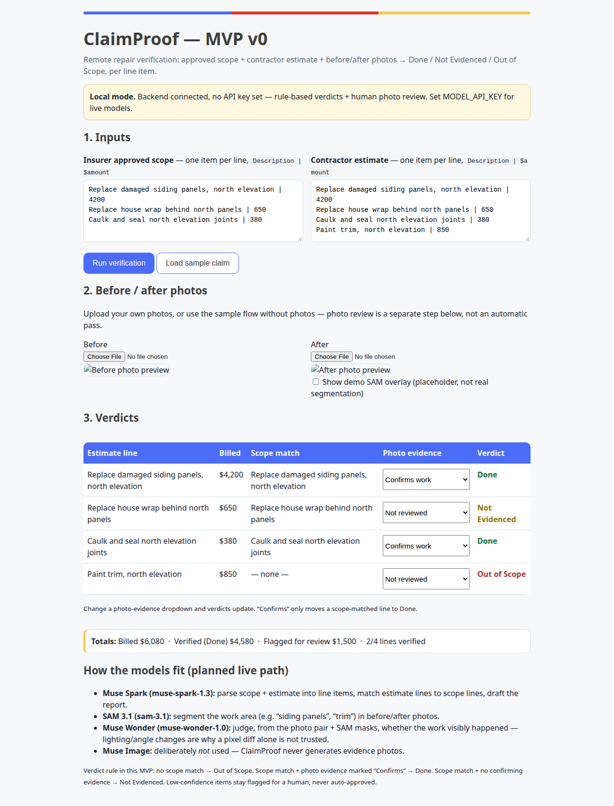
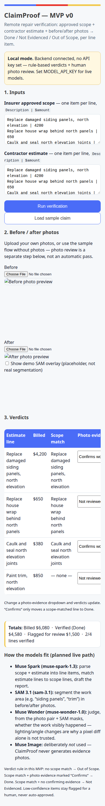

# ClaimProof

**Remote repair verification for landlords — built for the Meta Global AI Developer Hackathon (Cerebral Valley), Oct 26 – Nov 4, 2026.**

**UI theme:** blue #4a6cf7, red #e8332a, yellow #f2c94c, dark gray #3d3d3d, with a blue/red/yellow accent bar. The UI is responsive (single column under 700px, scrollable verdict table, 44px tap targets).

- **Track:** Indie developer (solo)
- **Theme:** Build for Your World
- **One line:** Upload an insurer's approved scope, a contractor's estimate, and before/after photos, and get a per-line verdict — Done / Not Evidenced / Out of Scope — with the evidence attached to each call and totals you can send to a manager or contractor.
- **Status:** Working application. All code in this repo was written Nov 3, 2026, during the hackathon window. No pre-existing codebase was reused; the problem story (a remote landlord's repair claim) predates the build, the code does not.

> **Demo video:** _to be recorded before submission — 90-second walkthrough, link added here and on the Cerebral Valley submission form._
>
> **Submission deadline:** Wed Nov 4, 2026, 9:00 PM ET / 6:00 PM PT, via the Cerebral Valley portal. The $150 Meta Model API credit claim closes at the same time.

## The problem, firsthand

A landlord in one state, a rental in another, and a repair stuck in a three-way loop nobody can close: what the insurer approved, what the contractor billed, and what the photos actually show. The concrete case that motivated this: siding work where the open question was whether trim painting was in the approved scope at all. If it wasn't, billing it is an Out of Scope flag — not a negotiation, a fact to check.

**Who benefits:** remote landlords, property managers, and contractors who want a shared, checkable record instead of another round of "did you do this?" emails. A manager can verify work without a site visit; a contractor gets paid faster on the lines that are actually evidenced.

## Demo (90 seconds)

1. **The stuck loop:** approved scope vs. estimate vs. photos, three sources disagreeing.
2. **Run the sample claim:** siding panels → Done, caulk/seal → Done, house wrap → Not Evidenced (billed, not visually confirmed), trim paint → Out of Scope (not in the approved scope).
3. **Totals + honesty line:** $6,080 billed, $4,580 verified, $1,500 flagged. Low-confidence items stay flagged for a human — never auto-approved.

Try it with the sample data first, then with your own scope/estimate text. All sample data in this repo is **synthetic**. Do not put real claim numbers, policy documents, or unredacted photos into a public submission or demo.

## Screenshots

Captured Nov 3, 2026 from the running local app (sample claim: siding and caulk Done, house wrap Not Evidenced, trim paint Out of Scope — $6,080 billed / $4,580 verified / $1,500 flagged):

Desktop:



Mobile (390px):



## How to run

Requirements: Python 3.10+, no third-party dependencies for the core app.

```bash
# Local mode (works now, no key needed)
python3 server.py
# open http://127.0.0.1:8000

# Live Meta model mode (once your $150 credit key arrives)
MODEL_API_KEY=<your key> python3 server.py
```

Or open `index.html` directly for the browser-only version (no saved claims, no live models).

### Storage: SQLite + local image files

- Claims live in SQLite (`claimproof.db`, table `claims`) — not a JSON file. Reopening a claim returns its verdicts, totals, evidence, and photo URLs.
- Photos live as files in `uploads/` (`<claim_id>_before.<ext>`, `<claim_id>_after.<ext>`), served at `GET /api/uploads/<filename>`. Only `png`, `jpeg`, `webp`, and `gif` data URLs are accepted, and the upload route guards against path traversal.
- Both `claimproof.db` and `uploads/` are git-ignored local state. For a hosted deployment, swap `uploads/` for object storage (S3-style) and back up the DB file — the claim record already stores photo paths, so that swap is contained.

### API

| Endpoint | What it does |
|---|---|
| `GET /api/health` | Reports `live` vs `local` mode, model IDs, and `sqlite+uploads` storage |
| `POST /api/verify` | `{scope, estimate, before?, after?, evidence?}` → saved claim with rows + totals + photo URLs |
| `GET /api/claims`, `GET /api/claims/<id>` | List / fetch saved claims |
| `POST /api/claims/<id>/evidence` | Update photo evidence for a claim, verdicts recompute |
| `GET /api/report/<id>` | Markdown report download |
| `GET /api/uploads/<file>` | Stored before/after photo |

### Environment

See `.env.example`. The only secret is `MODEL_API_KEY` — never commit it. `claimproof.db` and `uploads/` are local state and are git-ignored.

## How it works

```
scope + estimate text
        │
        ▼
Muse Spark ──► normalised line items (live mode; local parser on error, labelled)
        │
        ▼
line matching (scope ↔ estimate, token overlap + match score)
        │
        ├─► no scope match ──────────────► Out of Scope
        ├─► scope match + photo confirms ► Done
        └─► scope match + no confirmation ► Not Evidenced
        │
before/after photos
        │
        ├─► SAM 3.1 ──► boxes/masks for "siding panels", "trim", …
        └─► Muse Wonder ──► multimodal judgement: did the work visibly happen?
                             (lighting/angle changes are not treated as work)
        │
        ▼
report: per-line verdict + evidence + totals (billed / verified / flagged)
```

## Use of Meta AI tooling — beyond a basic integration

| Model | Where it is used | Why that model, specifically |
|---|---|---|
| **Muse Spark** (`muse-spark-1.3`) | Parses scope + estimate into structured line items; drafts the report | Text-heavy, structured output, cheaper — the right cost/quality split |
| **SAM 3.1** (`sam-3.1`) | Segments the work area in before/after photos from a short noun phrase, via the Responses API | Pixel-precise masks anchor a verdict to a place in the photo, not just to text |
| **Muse Wonder** (`muse-wonder-1.0`) | Judges the photo pair + SAM masks: did this repair visibly happen? | A pixel diff alone fails on lighting and camera-angle changes; this is a judgement call, and Wonder is the multimodal judge |
| **Muse Image** | Deliberately **not** used | Generating repair photos would defeat verification. ClaimProof verifies real photos; it never synthesises evidence |

The cost-smart split matters on a $150 credit budget: Wonder runs only on the photo-judgement step, Spark handles the text-heavy steps, SAM runs once per concept per photo.

**Honest state of the live path:** the client (`meta_api.py`) is written against Meta's documented surface — base URL `https://api.meta.ai/v1`, Bearer `MODEL_API_KEY`, OpenAI-compatible chat completions for Spark/Wonder, Responses API for SAM — but it has not yet been exercised against a live key, because the $150 credit key has not arrived yet. Without a key the app runs in labelled local mode and never presents a rule-based result as a model result. An API error is surfaced in `model_notes` and falls back to the local parser, explicitly labelled. Full SAM mask decoding needs the official `meta-sam-parser` package if installed; without it, boxes + counts are returned, no mask is faked.

## Technical depth

- **Zero-dependency backend:** Python standard library only (`server.py`), so the app runs anywhere Python does with no install step to break during a demo.
- **Deterministic fallback:** the local parser/matcher is rule-based and auditable — same input, same verdict, with a match score shown per line.
- **Human-in-the-loop by design:** photo evidence is a separate, explicit step. "Confirms" is the only path from Not Evidenced to Done in local mode.
- **Real persistence:** claims save to SQLite, photos save as files in `uploads/`, evidence updates recompute verdicts and totals, reports export as Markdown.
- **No silent failures:** missing key, API error, and empty SAM match are three different states, and the UI/backend distinguish all three.
- **Tested:** backend verified end-to-end Nov 3, 2026 — sample claim returns $6,080 billed / $4,580 verified / $1,500 flagged, 2/4 lines verified, and a correct Markdown report.

## Project structure

```
index.html        # UI: inputs, photo upload/preview, verdict table, report link
server.py         # Working backend: verify, claims, evidence, report, health
meta_api.py       # Meta Model API client: Spark, SAM 3.1, Wonder (key from env)
sample-data.json  # Synthetic sample claim + expected verdicts/totals
.env.example      # Environment variables (no secrets)
```

## Limitations — stated plainly

- This is a **verification report, not a claims decision**. It does not approve payment, adjudicate coverage, or give insurance advice. Final payment decisions stay with the landlord/insurer.
- Photo judgement in local mode is human review, not computer vision. In live mode it depends on photo quality, angle, and lighting.
- Scope/estimate parsing in the UI is line-based (`Description | $amount`); PDF upload parsing is a next step, not shipped.
- No authentication, multi-user accounts, or insurer API integrations — deliberately cut for the deadline.

## Roadmap (future only — not shipped)

1. Live-key verification run + demo video with live SAM overlays
2. PDF scope/estimate upload parsing
3. PDF report export + shareable report links
4. Multiple photos per line item, date-stamped photo timeline
5. Saved claims dashboard + contractor comparison

## Judging-criteria map

| Criterion (official rules) | Where ClaimProof answers it |
|---|---|
| Impact (30%) | Real landlord/manager/contractor loop, firsthand problem, usable beyond the demo |
| Use of Meta AI Tooling (25%) | Spark + SAM 3.1 + Wonder, each for the job only it can do; Image deliberately excluded for integrity |
| Technical Depth & Execution (20%) | Working backend, persistence, deterministic fallback, honest error states, tested totals |
| Demo (25%) | Working app + 90-second video (link above when recorded); demo holds up live in local mode, live mode with a key |

## License

MIT — see `LICENSE` (or the repo's license file if added at publish time).
